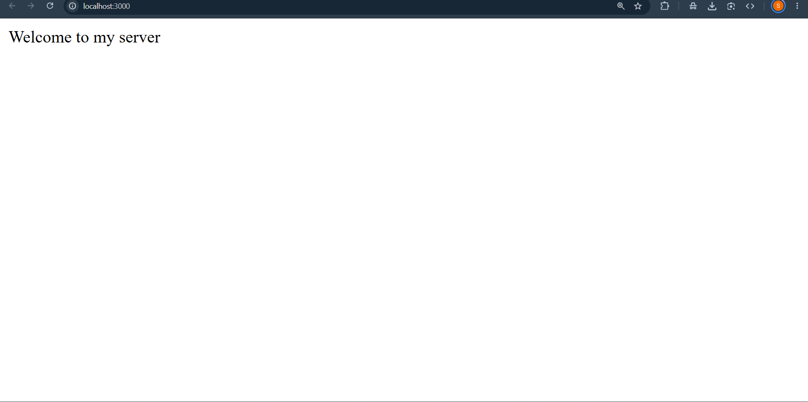
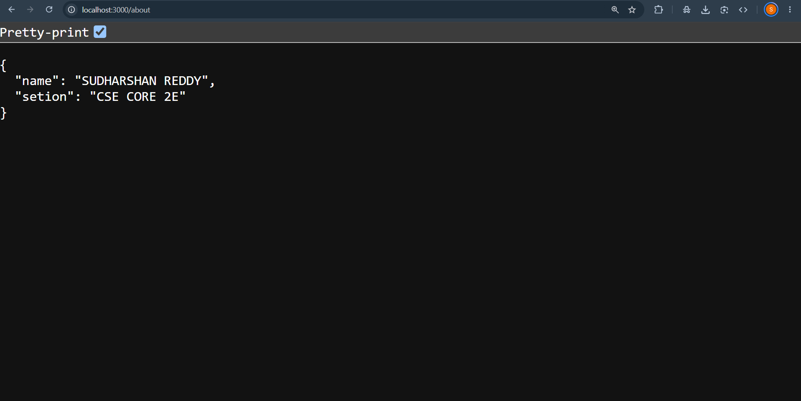
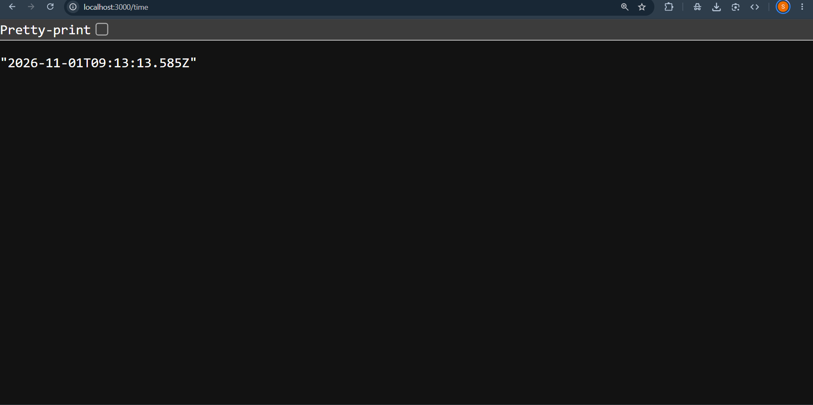

# Lab 1: Node.js and Express Server

> **Local Server URL:** [http://localhost:3000](http://localhost:3000)

---

## 📋 Student & Curriculum Information

| Field | Details |
|---|---|
| **Student Name** | Uppu Rishi Kumar |
| **Registration Number** | 252U1R1245 |
| **Section** | CSE-CORE-2E |
| **Course** | Backend Development Fundamentals |
| **Faculty** | Mr Yugandhar Gurjalwar |
| **Institution** | Aurora Deemed-to-be-University |
| **GitHub Repository** | [https://github.com/uppurishikumar-creator/backend.git](https://github.com/uppurishikumar-creator/backend.git) |
| **Repository Path** | `lab-01/` in course GitHub repository |

---

## 🎯 Objective

Establish a robust Node.js backend environment from the ground up. Understand the single-threaded event loop architecture of the V8 JavaScript engine, construct foundational web servers using both the built-in Node.js `http` module and the lightweight **Express.js** framework, configure declarative REST route handlers (`/`, `/about`, `/time`), implement proper HTTP status codes (`200 OK`, `404 Not Found`), and configure **Nodemon** for automated hot-reloading during development.

---

## 🛠️ Technologies Used

| Technology | Purpose |
|---|---|
| **Node.js** | Non-blocking, asynchronous JavaScript runtime environment for backend execution |
| **Express.js** | Minimalist, fast, and unopinionated web framework for Node.js routing and middleware |
| **JavaScript (ES6+)** | Core language utilizing modern arrow functions and object destructuring |
| **npm (Node Package Manager)** | Package management ecosystem for dependency resolution and script execution |
| **Nodemon** | Utility that monitors file changes in the directory and automatically restarts the server |
| **VS Code REST Client** | In-editor HTTP client for sending requests and inspecting response bodies and headers |
| **Git & GitHub** | Distributed version control and remote code repository tracking |

---

## 📁 Project Structure

```text
lab-01/
├── node_modules/        # Installed npm dependencies (git-ignored)
├── screenshots/         # Functional verification evidence screenshots
│   ├── 404.png          # 404 Route Not Found response
│   ├── about.png        # GET /about response with student metadata
│   ├── home.png         # GET / welcome response
│   └── time.png         # GET /time current server timestamp response
├── .gitignore           # Excludes node_modules and system files from Git
├── lab-01.http          # REST Client request specification file
├── package.json         # Project metadata, scripts, and dependency definitions
├── package-lock.json    # Exact dependency tree lockfile
├── README.md            # Comprehensive Lab 1 documentation
└── server.js            # Express application entry point and route handlers
```

---

## 🔌 Server Architecture & Routing Lifecycle

The Express application is constructed in [`server.js`](server.js):

1. **Instance Instantiation:** Initializes the Express application instance via `const app = express()`.
2. **Deterministic Route Ordering:** 
   - Express matches requests sequentially from top to bottom.
   - Specific route endpoints (`/`, `/about`, `/time`) are declared first.
3. **Catch-All 404 Middleware:**
   - Appended at the end of the routing stack using `app.use((request, response) => { ... })`.
   - Any request that fails to match a defined endpoint falls through to this handler, ensuring consistent `404 Not Found` responses.
4. **Listener Binding:** 
   - Binds to port `3000` via `app.listen(3000)`.

---

## ⚙️ Installation & Setup

### Prerequisites

- **Node.js**: v18.x or v20.x LTS installed
- **npm**: v9.x or later (bundled with Node.js)

### Step-by-Step Setup

1. **Navigate to the Lab 1 directory:**
   ```powershell
   cd "lab-01"
   ```

2. **Install project dependencies:**
   ```powershell
   npm install
   ```

3. **Start the Application:**
   - **Development Mode (with auto-reload via Nodemon):**
     ```powershell
     npm run dev
     ```
   - **Standard Mode (Node runtime):**
     ```powershell
     node server.js
     ```

4. **Local Server Endpoint:**
   ```
   http://localhost:3000/
   ```

---

## 📡 API Endpoints Directory

| HTTP Method | Route Endpoint | Live URL | Response Data Type | Description | Expected Status |
|:---:|---|:---:|:---:|---|:---:|
| `GET` | `/` | [Open Live Link](http://localhost:3000/) | `text/html` | Server greeting and welcome message | `200 OK` |
| `GET` | `/about` | [Open Live Link](http://localhost:3000/about) | `application/json` | Student identity, academic section, and metadata | `200 OK` |
| `GET` | `/time` | [Open Live Link](http://localhost:3000/time) | `text/plain` | Dynamic ISO server timestamp generated via `new Date()` | `200 OK` |
| `ALL` | `/*` | [Open Live Link (404 Test)](http://localhost:3000/contact) | `text/plain` | Global fallback handler for undefined endpoints | `404 Not Found` |

---

## 📝 Request & Expected Response Specifications

### 1. Root Greeting Endpoint (`GET /`)
- **Request:** `GET http://localhost:3000/`
- **Response Status:** `200 OK`
- **Response Body:**
  ```text
  Welcome to my server
  ```

### 2. Student Metadata Endpoint (`GET /about`)
- **Request:** `GET http://localhost:3000/about`
- **Response Status:** `200 OK`
- **Response Body (`application/json`):**
  ```json
  {
    "name": "Uppu Rishi Kumar",
    "setion": "CSE CORE 2E"
  }
  ```

### 3. Server Timestamp Endpoint (`GET /time`)
- **Request:** `GET http://localhost:3000/time`
- **Response Status:** `200 OK`
- **Response Body:**
  ```text
  2026-11-01T09:12:34.567Z
  ```

### 4. Undefined Route Handler (`GET /contact` or any unmatched path)
- **Request:** `GET http://localhost:3000/contact`
- **Response Status:** `404 Not Found`
- **Response Body:**
  ```text
  Page not found
  ```

---

## 🧪 Comprehensive Verification Suite (`lab-01.http`)

The test suite validates both successful routes and missing endpoints:

| # | Test Scenario | HTTP Method | Endpoint | Expected Status | Result |
|:---:|---|:---:|---|:---:|:---:|
| 1 | Welcome Route Verification | `GET` | `http://localhost:3000/` | `200 OK` | `200 OK` |
| 2 | Student Metadata Verification | `GET` | `http://localhost:3000/about` | `200 OK` | `200 OK` |
| 3 | Server Timestamp Verification | `GET` | `http://localhost:3000/time` | `200 OK` | `200 OK` |
| 4 | Unknown Route Catch-All Test | `GET` | `http://localhost:3000/contact` | `404 Not Found` | `404 Not Found` |

---

## 📸 Screenshots Directory & Evidence

Screenshots are placed in the [`screenshots/`](screenshots/) directory, documenting all required functional outputs:

### 1. Welcome Route (`GET /`)
- **Local URL:** [http://localhost:3000/](http://localhost:3000/)
- **Expected HTTP Status:** `200 OK`

Renders the default root welcome message from the Express server:


### 2. About Route (`GET /about`)
- **Local URL:** [http://localhost:3000/about](http://localhost:3000/about)
- **Expected HTTP Status:** `200 OK`

Displays structured student information and academic section in JSON format:


### 3. Server Time Route (`GET /time`)
- **Local URL:** [http://localhost:3000/time](http://localhost:3000/time)
- **Expected HTTP Status:** `200 OK`

Demonstrates dynamic server execution returning the ISO timestamp via `new Date()`:


### 4. 404 Route Not Found Handler
- **Local URL:** [http://localhost:3000/contact](http://localhost:3000/contact)
- **Expected HTTP Status:** `404 Not Found`

Validates the fallback middleware intercepting unmatched paths with `404 Not Found`:


---

## 🚀 Deployment on Render

### Steps to Deploy

1. **Sign up** on [Render](https://render.com/) using your GitHub account.

2. **Create a New Web Service:**
   - Click **"New +"** → **"Web Service"**
   - Connect your GitHub repository: `backend`

3. **Configure the Service:**

   | Setting | Value |
   |---------|-------|
   | **Name** | `backend-lab-lab-01` |
   | **Root Directory** | `lab-01` |
   | **Runtime** | `Node` |
   | **Build Command** | `npm install` |
   | **Start Command** | `node server.js` |
   | **Environment Variable** | `NODE_VERSION: 20.18.0` |

4. **Deploy** and wait for the build to complete.

5. **Verify the local endpoints before deployment:**
   - **Main Server / Greeting:** [http://localhost:3000/](http://localhost:3000/)
   - **Student About Info:** [http://localhost:3000/about](http://localhost:3000/about)
   - **Server Time:** [http://localhost:3000/time](http://localhost:3000/time)
   - **404 Error Test:** [http://localhost:3000/contact](http://localhost:3000/contact)

---

## ❗ Notes: Problems Faced and Solutions

| # | Challenge / Issue | Root Cause | Diagnosis & Resolution |
|:---:|---|---|---|
| **1** | **Port Conflict (`EADDRINUSE`)** | An existing background Node.js process was holding port `3000`. | Terminated the lingering process using PowerShell (`Stop-Process -Name node -Force`) or Task Manager before relaunching Nodemon. |
| **2** | **404 Catch-All Precedence** | Placing `app.use((req, res) => ...)` before specific `app.get()` routes intercepted and blocked all subsequent endpoints. | Repositioned the catch-all middleware to the very bottom of `server.js` so it executes only if no earlier routes match. |
| **3** | **Manual Server Restarts** | Plain Node runtime required stopping and restarting the server on every source code edit. | Configured `nodemon` as a development dependency in `package.json` with a dedicated `"dev": "nodemon server.js"` script for hot reloading. |
| **4** | **Content-Type Serialization** | Discrepancy between text responses and JSON payloads. | Utilized Express's smart serialization in `response.send()`: strings are automatically sent with `text/html; charset=utf-8`, while JS objects are formatted as `application/json`. |

---

## 🎓 Viva Voce Questions & Answers

| # | Question | Comprehensive Answer |
|:---:|---|---|
| **1** | **What is Node.js and how does its single-threaded event loop work?** | Node.js is an open-source, cross-platform JavaScript runtime built on Chrome's V8 engine. It uses an **event-driven, non-blocking I/O model**. Although JavaScript executes on a single main thread, long-running operations (file system, network I/O) are offloaded to background worker threads via the **libuv** library. Once completed, callbacks are queued into the event loop and executed on the main thread without blocking incoming traffic. |
| **2** | **What is the difference between Node's built-in `http` module and Express.js?** | The built-in `http` module (`http.createServer()`) provides low-level networking primitives where routing, URL parsing, request body chunks, MIME headers, and query strings must be parsed manually. **Express.js** is a higher-level abstraction that provides declarative routing (`app.get`, `app.post`), built-in middleware support (`express.json()`), convenience response helpers (`res.send()`, `res.json()`, `res.status()`), and scalable architectural patterns. |
| **3** | **What is Express middleware and why is route ordering critical?** | Middleware functions have access to the `request`, `response`, and `next` objects in the application lifecycle. They can execute code, modify request/response objects, end the cycle, or call `next()`. Route ordering is critical because Express executes middleware and routes strictly in the order they are registered. Placing a catch-all 404 handler at the top would block all subsequent routes. |
| **4** | **What is the difference between `package.json` and `package-lock.json`?** | `package.json` defines project metadata, scripts, and semantic version ranges (e.g. `^5.1.0`) for dependencies. `package-lock.json` records the exact, deterministic dependency tree (exact versions, resolved URLs, and integrity cryptographic hashes) installed at that moment, ensuring identical installs across different machines and environments. |
| **5** | **Why should Nodemon only be used in development rather than production?** | Nodemon continuously watches the filesystem and consumes extra memory and CPU resources to monitor directory changes. In production, code does not change on the fly; servers should be run using standard `node` and managed by process supervisors (such as PM2, Docker, or systemd) that optimize for memory stability, performance, and automated crash restarts. |

---

## 📜 Core Rules & Academic Integrity

- **Environment & Dependency Safety:** `node_modules/` is strictly excluded from version control via `.gitignore`.
- **HTTP Semantics:** Every route returns semantically accurate HTTP status codes (`200 OK`, `404 Not Found`).
- **Clean Architecture:** Modular separation of dependencies, scripts, and route handlers.
- **Originality:** Code and documentation are authored and maintained by the student.

---

## ✅ Conclusion

Through **Lab 1**, I achieved the following learning outcomes:
1. Initialized a Node.js project and managed dependencies using `npm`.
2. Built an asynchronous HTTP server using both standard Node primitives and Express.js.
3. Implemented clean, modular route handlers returning text, JSON, and dynamic timestamp data.
4. Designed a global 404 fallback mechanism to handle unrecognized endpoints gracefully.
5. Configured Nodemon for an efficient, hot-reloading development workflow.

---

## 👤 Author & Academic Attribution

**Uppu Rishi Kumar**<br>
**Registration Number:** `252U1R1245`
**Section:** `CSE-CORE-2E`  
**Department of Computer Science & Engineering**  
**Aurora Deemed-to-be-University**
