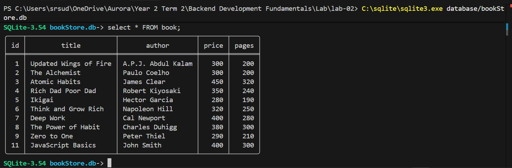
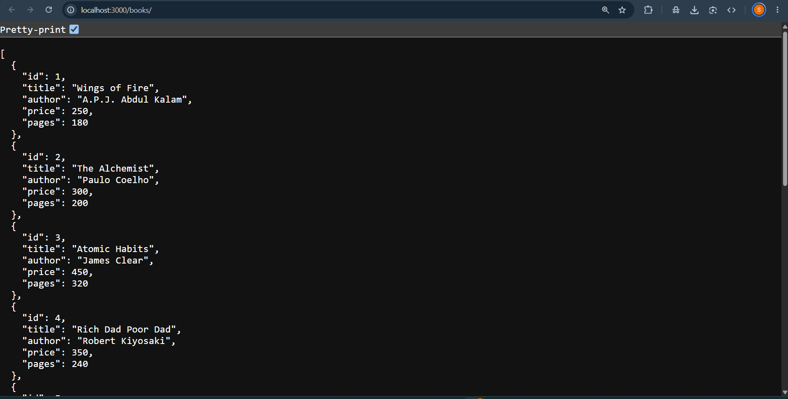
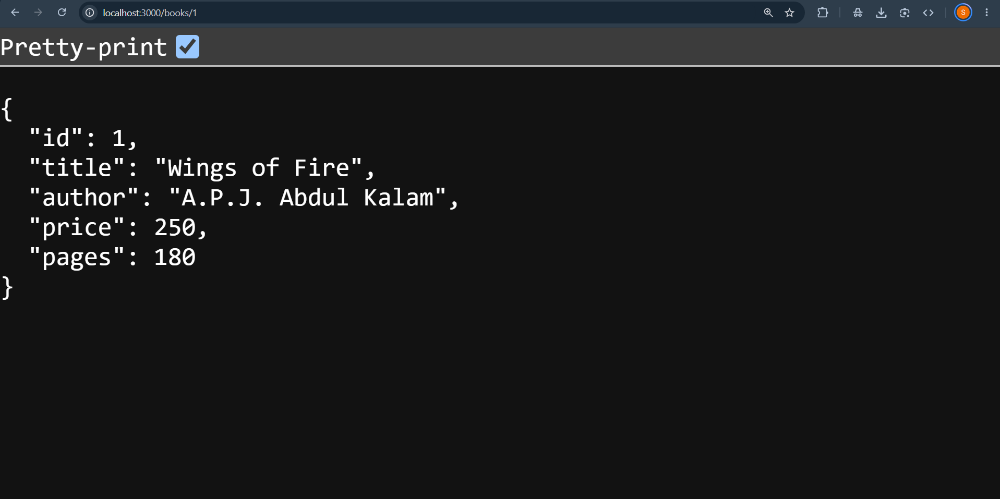
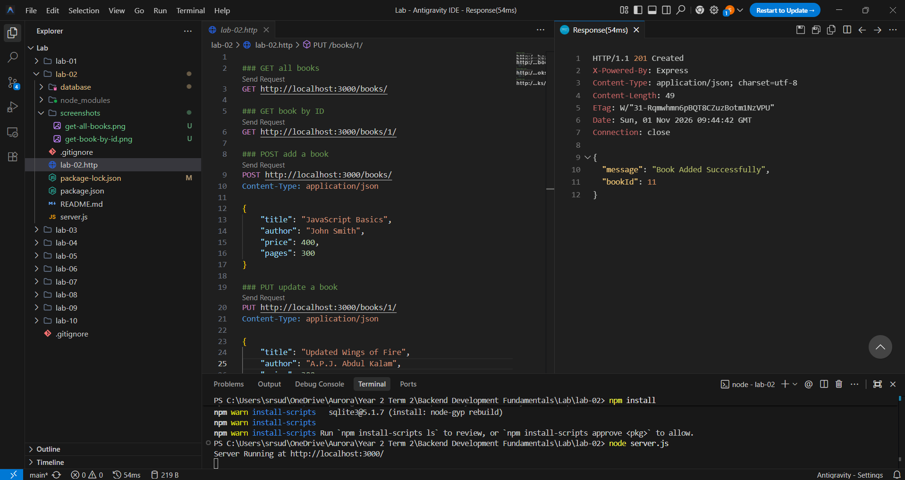
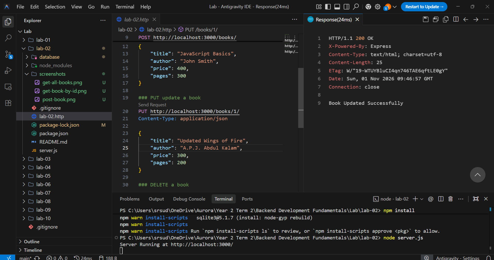
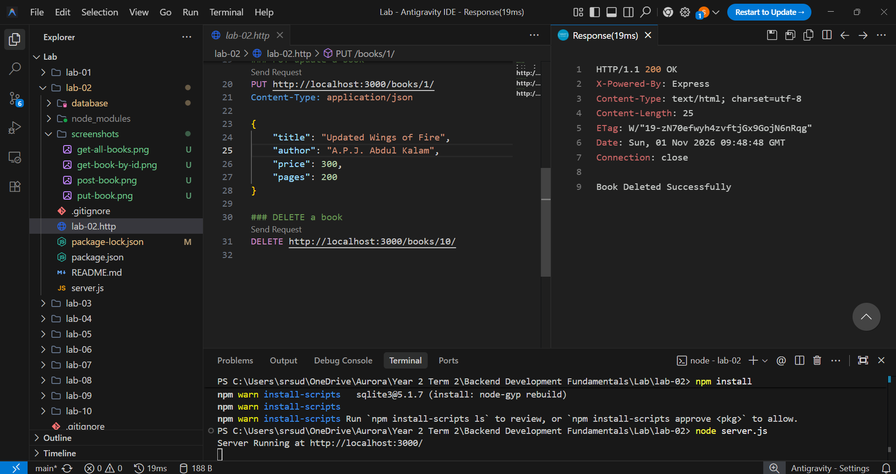

# Lab 2: SQLite Database and CRUD Routes

> **Local Server URL:** [http://localhost:3000](http://localhost:3000)

---

## 📋 Student & Curriculum Information

| Field | Details |
|---|---|
| **Student Name** | Uppu Rishi Kumar |
| **Registration Number** | 252U1R1245 |
| **Section** | CSE-CORE-2E |
| **Course** | Backend Development Fundamentals |
| **Faculty** | Mr Yugandhar Gurjalwar |
| **Institution** | Aurora Deemed-to-be-University |
| **GitHub Repository** | [https://github.com/uppurishikumar-creator/backend.git](https://github.com/uppurishikumar-creator/backend.git) |
| **Repository Path** | `lab-02/` in course GitHub repository |

---

## 🎯 Objective

Integrate an embedded **SQLite** database into an **Express.js** application. Establish asynchronous database connections using the `sqlite3` driver and the promise-based `sqlite` wrapper (`open()`), build complete CRUD (Create, Read, Update, Delete) HTTP route handlers for the `book` entity, apply parameterized queries (`?`) to prevent SQL injection vulnerabilities, implement clean status code semantics (`200 OK`, `201 Created`, `404 Not Found`), and verify database state both through REST client requests and the SQLite CLI.

---

## 🛠️ Technologies Used

| Technology | Purpose |
|---|---|
| **Node.js** | Server-side JavaScript runtime environment executing asynchronous I/O |
| **Express.js** | Minimalist web framework for routing, request parsing, and response dispatching |
| **SQLite** | Serverless, self-contained, transactional relational database engine |
| **sqlite & sqlite3** | Promise-based SQLite client and native C++ database driver for Node.js |
| **JavaScript (ES6+)** | Modern JavaScript utilizing `async/await` for promise-based database calls |
| **Nodemon** | Automated development server reloader triggered by source file changes |
| **VS Code REST Client** | In-editor tool for executing structured `.http` API request files |
| **Git & GitHub** | Distributed version control and remote code repository tracking |

---

## 🗄️ Database Structure

**Database File:** `database/bookStore.db`  
**Table:** `book`

```sql
CREATE TABLE IF NOT EXISTS book (
  id INTEGER PRIMARY KEY AUTOINCREMENT,
  title TEXT NOT NULL,
  author TEXT NOT NULL,
  price INTEGER NOT NULL,
  pages INTEGER NOT NULL
);
```

| Column | Data Type | Constraints | Description |
|---|---|---|---|
| `id` | INTEGER | PRIMARY KEY AUTOINCREMENT | Unique sequential identifier for each book record |
| `title` | TEXT | NOT NULL | Title of the book |
| `author` | TEXT | NOT NULL | Author of the book |
| `price` | INTEGER | NOT NULL | Price in Indian Rupees (₹) |
| `pages` | INTEGER | NOT NULL | Total page count |

---

## 📁 Project Structure

```text
lab-02/
├── database/            # SQLite database storage directory
│   └── bookStore.db     # SQLite binary database file (git-ignored)
├── screenshots/         # Functional and database verification screenshots
│   ├── database.png     # SQLite CLI database verification
│   ├── delete-book.png  # DELETE /books/:bookId/ response
│   ├── get-all-books.png# GET /books/ response
│   ├── get-book-by-id.png# GET /books/:bookId/ response
│   ├── post-book.png    # POST /books/ 201 Created response
│   └── put-book.png     # PUT /books/:bookId/ 200 OK response
├── .gitignore           # Excludes node_modules, database files, and environment files
├── lab-02.http          # REST Client request specification file
├── package.json         # Project metadata, scripts, and dependency definitions
├── package-lock.json    # Exact dependency tree lockfile
├── README.md            # Comprehensive Lab 2 documentation
└── server.js            # Express server entry point, database initialization & CRUD routes
```

---

## 🔌 Database Initialization & Architecture

The application implements an asynchronous initialization workflow via `initializeDBAndServer()`:

1. **Path Resolution:** Resolves the absolute database path using `path.join(__dirname, 'database', 'bookStore.db')` to eliminate working-directory path resolution errors across different operating systems.
2. **Asynchronous Connection:** Connects to the database using `await open({ filename: dbPath, driver: sqlite3.Database })`.
3. **Server Listener:** Upon a successful database connection, the Express server begins listening on port `3000`.
4. **Error Resilience:** Wraps connection logic in a `try...catch` block, logging diagnostic details and invoking `process.exit(1)` if database initialization fails.

---

## ⚙️ Installation & Setup

### Prerequisites

- **Node.js**: v18.x or v20.x LTS installed
- **npm**: v9.x or later (bundled with Node.js)
- **SQLite CLI**: (Optional, for direct terminal database queries)

### Step-by-Step Setup

1. **Navigate to the Lab 2 directory:**
   ```powershell
   cd "lab-02"
   ```

2. **Install project dependencies:**
   ```powershell
   npm install
   ```

3. **Database Directory Setup:**
   Ensure the `database/` folder exists and contains `bookStore.db`:
   ```powershell
   mkdir database
   ```

4. **Initialize Table Schema & Seed Records (via SQLite CLI):**
   ```powershell
   sqlite3 database/bookStore.db
   ```
   At the SQLite prompt:
   ```sql
   CREATE TABLE IF NOT EXISTS book (
     id INTEGER PRIMARY KEY AUTOINCREMENT,
     title TEXT,
     author TEXT,
     price INTEGER,
     pages INTEGER
   );

   INSERT INTO book (title, author, price, pages) VALUES
   ('Wings of Fire', 'A.P.J. Abdul Kalam', 250, 180),
   ('The Alchemist', 'Paulo Coelho', 300, 200),
   ('Atomic Habits', 'James Clear', 450, 320);

   .exit
   ```

5. **Start the Server:**
   - **Development Mode (with auto-reload via Nodemon):**
     ```powershell
     npm run dev
     ```
   - **Standard Mode (Node runtime):**
     ```powershell
     node server.js
     ```

6. **Local Server Endpoint:**
   ```
   http://localhost:3000/
   ```

---

## 📡 API Endpoints Directory

All resource endpoints adhere to REST conventions: resources are identified as nouns (`/books/`), and HTTP verbs dictate the operation performed.

| HTTP Method | Route Endpoint | Live URL | Description | Success Status | Error Status |
|:---:|---|:---:|---|:---:|:---:|
| `GET` | `/books/` | [Open Live Link](http://localhost:3000/books/) | Retrieve a list of all book records | `200 OK` | `500 Internal Error` |
| `GET` | `/books/:bookId/` | [Open Live Link (ID 1)](http://localhost:3000/books/1/) | Retrieve a single book record by ID | `200 OK` | `404 Not Found` |
| `POST` | `/books/` | [API Endpoint](http://localhost:3000/books/) | Create and insert a new book record | `201 Created` | `500 Internal Error` |
| `PUT` | `/books/:bookId/` | [API Endpoint (ID 1)](http://localhost:3000/books/1/) | Update all attributes of an existing book record by ID | `200 OK` | `404 Not Found` |
| `DELETE` | `/books/:bookId/` | [API Endpoint (ID 1)](http://localhost:3000/books/1/) | Remove an existing book record by ID | `200 OK` | `404 Not Found` |

---

## 📝 Request & Expected Response Specifications

### 1. GET /books/ (Retrieve All Books)
- **Request:** `GET http://localhost:3000/books/`
- **Response Status:** `200 OK`
- **Response Body (`application/json`):**
  ```json
  [
    {
      "id": 1,
      "title": "Wings of Fire",
      "author": "A.P.J. Abdul Kalam",
      "price": 250,
      "pages": 180
    },
    {
      "id": 2,
      "title": "The Alchemist",
      "author": "Paulo Coelho",
      "price": 300,
      "pages": 200
    }
  ]
  ```

### 2. GET /books/:bookId/ (Retrieve Single Book)
- **Request:** `GET http://localhost:3000/books/1/`
- **Response Status:** `200 OK`
- **Response Body (`application/json`):**
  ```json
  {
    "id": 1,
    "title": "Wings of Fire",
    "author": "A.P.J. Abdul Kalam",
    "price": 250,
    "pages": 180
  }
  ```
- **Failure Case (ID does not exist):**
  - **Request:** `GET http://localhost:3000/books/999/`
  - **Response Status:** `404 Not Found`
  - **Response Body:** `Book Not Found`

### 3. POST /books/ (Create Book)
- **Request:** `POST http://localhost:3000/books/`
- **Request Body (`application/json`):**
  ```json
  {
    "title": "Clean Code",
    "author": "Robert C. Martin",
    "price": 650,
    "pages": 464
  }
  ```
- **Response Status:** `201 Created`
- **Response Body:**
  ```json
  {
    "message": "Book Added Successfully",
    "bookId": 4
  }
  ```

### 4. PUT /books/:bookId/ (Update Book)
- **Request:** `PUT http://localhost:3000/books/1/`
- **Request Body (`application/json`):**
  ```json
  {
    "title": "Wings of Fire (Special Edition)",
    "author": "A.P.J. Abdul Kalam",
    "price": 299,
    "pages": 200
  }
  ```
- **Response Status:** `200 OK`
- **Response Body:** `Book Updated Successfully`
- **Failure Case (ID does not exist):** `404 Not Found` (`Book Not Found`)

### 5. DELETE /books/:bookId/ (Delete Book)
- **Request:** `DELETE http://localhost:3000/books/1/`
- **Response Status:** `200 OK`
- **Response Body:** `Book Deleted Successfully`
- **Failure Case (ID does not exist):** `404 Not Found` (`Book Not Found`)

---

## 🛡️ SQL Injection Prevention & Parameterized Queries

A fundamental security requirement in database-backed applications is separating SQL instructions from user-supplied parameters.

### Vulnerable Approach (String Concatenation — NEVER USE):
```javascript
// DANGEROUS: Susceptible to SQL Injection
const getBookQuery = `SELECT * FROM book WHERE id = ${bookId};`;
```

### Secure Approach Implemented (Parameterized Queries with `?`):
```javascript
// SECURE: User data bound as literal values via prepared statement
const getBookQuery = `SELECT * FROM book WHERE id = ?;`;
const book = await db.get(getBookQuery, [bookId]);
```

1. **Query Pre-Compilation:** The SQLite engine pre-compiles the query template before values are supplied.
2. **Literal Binding:** All values inside the array (`[bookId]`, `[title, author, price, pages]`) are treated strictly as data literals, rendering any malicious SQL fragments completely harmless.

---

## 🧪 Comprehensive Verification Suite (`lab-02.http`)

The test suite validates full CRUD capabilities, entity creation, modification, and missing record handling:

| # | Test Scenario | HTTP Method | Endpoint | Expected Status | Result |
|:---:|---|:---:|---|:---:|:---:|
| 1 | Retrieve All Books | `GET` | `http://localhost:3000/books/` | `200 OK` | `200 OK` |
| 2 | Retrieve Existing Book by ID | `GET` | `http://localhost:3000/books/1/` | `200 OK` | `200 OK` |
| 3 | Retrieve Non-Existent Book (404) | `GET` | `http://localhost:3000/books/999/` | `404 Not Found` | `404 Not Found` |
| 4 | Insert New Book Record | `POST` | `http://localhost:3000/books/` | `201 Created` | `201 Created` |
| 5 | Update Existing Book Record | `PUT` | `http://localhost:3000/books/1/` | `200 OK` | `200 OK` |
| 6 | Update Non-Existent Book (404) | `PUT` | `http://localhost:3000/books/999/` | `404 Not Found` | `404 Not Found` |
| 7 | Delete Existing Book Record | `DELETE` | `http://localhost:3000/books/1/` | `200 OK` | `200 OK` |
| 8 | Delete Non-Existent Book (404) | `DELETE` | `http://localhost:3000/books/999/` | `404 Not Found` | `404 Not Found` |

---

## 🧪 SQLite CLI Verification

Direct verification performed inside the SQLite command-line interface:

```bash
sqlite3 database/bookStore.db
```

```sql
.headers on
.mode column

-- 1. View all books before mutations:
SELECT id, title, author, price, pages FROM book;

-- 2. Verify record insertion after POST:
SELECT id, title, author, price, pages FROM book WHERE id = 4;

-- 3. Verify record update after PUT:
SELECT id, title, price, pages FROM book WHERE id = 1;

-- 4. Verify record deletion after DELETE:
SELECT id, title FROM book WHERE id = 1;
-- (Expected result: 0 rows returned)

.exit
```

---

## 📸 Screenshots Directory & Evidence

Screenshots are placed in the [`screenshots/`](screenshots/) directory, documenting all required functional outputs and database verifications:

### 1. SQLite Database CLI Verification
- **Expected Status:** `Database State Verified`

Direct inspection of the `bookStore.db` database file and table records:


### 2. GET All Books (`GET /books/`)
- **Local URL:** [http://localhost:3000/books/](http://localhost:3000/books/)
- **Expected HTTP Status:** `200 OK`

Retrieves the complete array of book records from the database with `200 OK`:


### 3. GET Book by ID (`GET /books/:bookId/`)
- **Local URL:** [http://localhost:3000/books/1/](http://localhost:3000/books/1/)
- **Expected HTTP Status:** `200 OK`

Retrieves a single book object by primary key with `200 OK`:


### 4. POST Create Book (`POST /books/`)
- **Expected HTTP Status:** `201 Created`

Inserts a new book record, returning `201 Created` along with the generated `lastID`:


### 5. PUT Update Book (`PUT /books/:bookId/`)
- **Expected HTTP Status:** `200 OK`

Updates existing record fields and confirms success with `200 OK`:


### 6. DELETE Book (`DELETE /books/:bookId/`)
- **Expected HTTP Status:** `200 OK`

Deletes an existing record by ID and confirms removal with `200 OK`:


---

## 🚀 Deployment on Render

### Steps to Deploy

1. **Sign up** on [Render](https://render.com/) using your GitHub account.

2. **Create a New Web Service:**
   - Click **"New +"** → **"Web Service"**
   - Connect your GitHub repository: `backend`

3. **Configure the Service:**

   | Setting | Value |
   |---------|-------|
   | **Name** | `backend-lab-lab-02` |
   | **Root Directory** | `lab-02` |
   | **Runtime** | `Node` |
   | **Build Command** | `npm install` |
   | **Start Command** | `node server.js` |
   | **Environment Variable** | `NODE_VERSION: 20.18.0` |

4. **Deploy** and wait for the build to complete.

5. **Verify the local endpoints before deployment:**
   - **GET All Books:** [http://localhost:3000/books/](http://localhost:3000/books/)
   - **GET Single Book (ID 1):** [http://localhost:3000/books/1/](http://localhost:3000/books/1/)
   - **GET 404 Error Test (ID 999):** [http://localhost:3000/books/999/](http://localhost:3000/books/999/)

---

## ❗ Notes: Problems Faced and Solutions

| # | Challenge / Issue | Root Cause | Diagnosis & Resolution |
|:---:|---|---|---|
| **1** | **Missing `await` on Database Operations** | Invoking `db.all()`, `db.get()`, or `db.run()` without `await` returned pending promises or empty objects `{}`. | Prepended `await` to every asynchronous database operation and ensured route callback functions were declared with `async (request, response) => { ... }`. |
| **2** | **Relative Path Resolution for SQLite** | Using `'./database/bookStore.db'` caused `SQLITE_CANTOPEN` errors when launching from different directories. | Used `path.join(__dirname, 'database', 'bookStore.db')` to construct a robust absolute path that works regardless of the terminal's current working directory. |
| **3** | **Handling Non-Existent Records on PUT & DELETE** | SQLite `UPDATE` and `DELETE` queries do not throw errors when matching 0 rows, which could result in a false `200 OK`. | Inspected `result.changes`: if `result.changes === 0`, returned `response.status(404).send('Book Not Found')`. |
| **4** | **Parsing JSON Request Bodies** | `request.body` returned `undefined` during `POST` and `PUT` operations. | Registered the built-in Express JSON parsing middleware at the application level: `app.use(express.json())`. |

---

## 🎓 Viva Voce Questions & Answers

| # | Question | Comprehensive Answer |
|:---:|---|---|
| **1** | **What is SQLite and why is it referred to as a "serverless" database?** | SQLite is a C-language library that implements a small, fast, self-contained, high-reliability SQL database engine. Unlike traditional client-server databases (e.g. PostgreSQL, MySQL) that run as independent background daemon processes listening on network ports, SQLite reads and writes directly to ordinary disk files (`.db`). It requires no configuration, no administration, and zero server provisioning. |
| **2** | **What is the difference between `db.all()`, `db.get()`, and `db.run()` in the `sqlite` package?** | • **`db.all(query, params)`**: Executes a `SELECT` query and returns a Promise resolving to an array of all matching rows (or an empty array `[]`).<br>• **`db.get(query, params)`**: Executes a `SELECT` query and returns only the first matching row object (or `undefined` if no row matches).<br>• **`db.run(query, params)`**: Executes non-query statements (`INSERT`, `UPDATE`, `DELETE`) and returns an execution result object containing `lastID` (the rowid of the last inserted row) and `changes` (the number of affected rows). |
| **3** | **How do parameterized queries (`?`) prevent SQL injection attacks?** | In parameterized queries, SQL statements are prepared with placeholders (`?`) before data values are supplied. The database engine parses and compiles the query structure first. When parameters are subsequently bound, they are treated strictly as data values and never evaluated as executable SQL syntax. Any injected SQL metacharacters (e.g. `' OR '1'='1`) are interpreted literally, neutralizing injection vectors. |
| **4** | **What is the difference between `POST` and `PUT` methods in REST?** | **`POST`** is typically non-idempotent and creates a new subordinate resource under a collection (e.g. `POST /books/`). The server generates the resource ID. **`PUT`** is idempotent and either updates an existing resource identified by a specific URI (e.g. `PUT /books/1/`) or replaces it entirely. Performing the same `PUT` request multiple times results in the same resource state, whereas repeated `POST` requests create duplicate resources. |
| **5** | **Why is checking `result.changes` necessary for `UPDATE` and `DELETE` routes?** | When an `UPDATE` or `DELETE` query executes against an ID that does not exist in the table, SQLite executes the command successfully without throwing an exception, reporting `changes: 0`. Without checking `result.changes`, the API would mistakenly return `200 OK` for an operation that did nothing. Checking `if (result.changes === 0)` enables the server to correctly return `404 Not Found`. |

---

## 📜 Core Rules & Academic Integrity

- **Environment & Dependency Safety:** `node_modules/` and database files (`database/*.db`) are excluded from Git via `.gitignore`.
- **HTTP Semantics:** Every route returns semantically accurate HTTP status codes (`200 OK`, `201 Created`, `404 Not Found`).
- **Data Protection:** All database interactions utilize parameterized queries; string concatenation in SQL queries is strictly prohibited.
- **Originality:** Code and documentation are authored and maintained by the student.

---

## ✅ Conclusion

Through **Lab 2**, I achieved the following learning outcomes:
1. Integrated an embedded SQLite relational database with an Express application using `sqlite` and `sqlite3`.
2. Designed and implemented complete RESTful CRUD operations across HTTP verbs (`GET`, `POST`, `PUT`, `DELETE`).
3. Managed asynchronous database interactions using modern `async/await` syntax.
4. Hardened database transactions against SQL injection using prepared statements and parameterized inputs (`?`).
5. Implemented robust status code logic and verified operations through REST Client and SQLite CLI.

---

## 👤 Author & Academic Attribution

**Uppu Rishi Kumar**<br>
**Registration Number:** `252U1R1245`
**Section:** `CSE-CORE-2E`  
**Department of Computer Science & Engineering**  
**Aurora Deemed-to-be-University**
