# Lab 3: REST API, Query Parameters, Validation, and Debugging

> **🔗 Live Deployment URL:** [https://backend-lab-lab-03.onrender.com](https://backend-lab-lab-03.onrender.com) *(or local server at `http://localhost:3000`)*

---

## 📋 Student & Curriculum Information

| Field | Details |
|---|---|
| **Student Name** | Uppu Rishi Kumar |
| **Registration Number** | 252U1R1245 |
| **Section** | CSE-CORE-2E |
| **Course** | Backend Development Fundamentals |
| **Faculty** | Mr Yugandhar Gurjalwar |
| **Institution** | Aurora Deemed-to-be-University |
| **GitHub Repository** | [https://github.com/ssrssudharshanreddy/backend_lab](https://github.com/ssrssudharshanreddy/backend_lab) |
| **Repository Path** | `lab-03/` in course GitHub repository |

---

## 🎯 Objective

Transform the foundational Lab 2 book routes into a robust, production-grade RESTful API. Implement advanced query parameters on `GET /books` (partial title search, sorting by field and direction, pagination using limit/offset, and price range filtering), enforce strict request payload validation with uniform JSON error responses, apply SQL injection defenses (parameterized queries and JavaScript identifier whitelisting), and systematically analyze and resolve four deliberate server debugging bugs.

---

## 🛠️ Technologies Used

| Technology | Purpose |
|---|---|
| **Node.js** | JavaScript runtime environment for executing server-side logic |
| **Express.js** | Minimalist web application framework for REST routing and middleware |
| **SQLite** | Serverless, self-contained, transactional relational database engine |
| **sqlite & sqlite3** | Promise-based SQLite client wrapper and native C++ SQLite driver for Node.js |
| **Nodemon** | Development tool for automated server restarts on source code changes |
| **REST Client / Postman** | Testing suite for sending HTTP requests and inspecting status codes and JSON bodies |
| **Git & GitHub** | Version control and remote repository management |
| **Render** | Cloud deployment platform for hosting the Node.js application |

---

## 🗄️ Database Structure

**Database File:** `database/bookStore.db`  
**Table:** `book`

```sql
CREATE TABLE IF NOT EXISTS book (
  id INTEGER PRIMARY KEY AUTOINCREMENT,
  title TEXT NOT NULL,
  author TEXT NOT NULL,
  price INTEGER NOT NULL,
  pages INTEGER NOT NULL
);
```

| Column | Data Type | Constraints | Description |
|---|---|---|---|
| `id` | INTEGER | PRIMARY KEY AUTOINCREMENT | Unique sequential identifier for each book record |
| `title` | TEXT | NOT NULL | Title of the book |
| `author` | TEXT | NOT NULL | Name of the book author |
| `price` | INTEGER | NOT NULL | Price in Indian Rupees (₹) |
| `pages` | INTEGER | NOT NULL | Total number of pages |

### Sample Seed Data (`database/seed.sql`)

| ID | Title | Author | Price (₹) | Pages |
|:---:|---|---|:---:|:---:|
| 1 | Wings of Fire | A.P.J. Abdul Kalam | 250 | 180 |
| 2 | The Alchemist | Paulo Coelho | 300 | 200 |
| 3 | Atomic Habits | James Clear | 450 | 320 |
| 4 | Rich Dad Poor Dad | Robert Kiyosaki | 350 | 240 |
| 5 | Ikigai | Hector Garcia | 280 | 190 |
| 6 | Think and Grow Rich | Napoleon Hill | 320 | 250 |
| 7 | Deep Work | Cal Newport | 400 | 280 |
| 8 | The Power of Habit | Charles Duhigg | 380 | 300 |
| 9 | Zero to One | Peter Thiel | 290 | 210 |
| 10 | The Psychology of Money | Morgan Housel | 350 | 250 |

---

## 🔌 Database Initialization & Architecture

The server implements asynchronous lifecycle startup via `initializeDBAndServer()`:

1. **Database Connection:** Resolves the absolute path to `database/bookStore.db` via `path.join(__dirname, 'database', 'bookStore.db')` and initializes the SQLite driver with asynchronous promises using `open()`.
2. **Schema & Seed Execution:** Table creation and data seeding are managed using SQLite CLI or external SQL scripts (`database/seed.sql`), ensuring clean separation between migration logic and application code.
3. **Port Binding & Fallback:** Binds the server to `process.env.PORT || 3000` to support dynamic port injection on cloud hosts (such as Render) and avoid hardcoded port collisions.
4. **Global Error Handling:** Gracefully catches connection and syntax failures with descriptive logging and `process.exit(1)`.

---

## ⚙️ Installation & Setup

### Prerequisites

- **Node.js**: v18.x or v20.x LTS installed
- **npm**: v9.x or later (bundled with Node.js)
- **SQLite CLI**: (Optional, for manual direct database inspection)

### Step-by-Step Setup

1. **Navigate to the Lab 3 directory:**
   ```powershell
   cd "lab-03"
   ```

2. **Install project dependencies:**
   ```powershell
   npm install
   ```

3. **Configure Environment Variables (Optional):**
   Create a `.env` file in the `lab-03/` root if a custom port is required (note: never commit `.env` to Git):
   ```env
   PORT=3000
   ```

4. **Initialize and Seed the Database:**
   Ensure the `database/` directory exists and execute the seed script:
   ```powershell
   # If sqlite3 is in your system PATH:
   sqlite3 database/bookStore.db ".read database/seed.sql"
   ```
   *Alternative manual interactive command:*
   ```powershell
   sqlite3 database/bookStore.db
   sqlite> .read database/seed.sql
   sqlite> .exit
   ```

5. **Start the Application:**
   - **Development Mode (with auto-reload via Nodemon):**
     ```powershell
     npm run dev
     ```
   - **Production Mode:**
     ```powershell
     npm start
     ```

6. **Local Server Endpoint:**
   ```
   http://localhost:3000/
   ```

---

## 📡 API Endpoints Directory

All resource endpoints adhere to REST conventions: resources are named as plural nouns (`/books`), and HTTP methods communicate the operation to perform.

| HTTP Method | Path | Live URL | Description | Success Code | Error Codes |
|:---:|---|:---:|---|:---:|:---:|
| `GET` | `/` | [Open Live Link](https://backend-lab-lab-03.onrender.com/) | API Directory, student metadata & system status | `200 OK` | `500` |
| `GET` | `/books` | [Open Live Link](https://backend-lab-lab-03.onrender.com/books) | Retrieve books with optional search, sorting, pagination, and price filters | `200 OK` | `400`, `500` |
| `GET` | `/books/:bookId` | [Open Live Link (ID 1)](https://backend-lab-lab-lab-03.onrender.com/books/1) | Retrieve a single book record by ID | `200 OK` | `400`, `404`, `500` |
| `POST` | `/books` | [API Endpoint](https://backend-lab-lab-03.onrender.com/books) | Validate payload and insert a new book record | `201 Created` | `400`, `500` |
| `PUT` | `/books/:bookId` | [API Endpoint (ID 1)](https://backend-lab-lab-03.onrender.com/books/1) | Validate payload and update an existing book by ID | `200 OK` | `400`, `404`, `500` |
| `DELETE` | `/books/:bookId` | [API Endpoint (ID 10)](https://backend-lab-lab-03.onrender.com/books/10) | Delete an existing book by ID | `200 OK` | `400`, `404`, `500` |
| `ALL` | `/*` | [Open Live Link (404 Test)](https://backend-lab-lab-03.onrender.com/books/99999) | Fallback route handler for undefined endpoints | — | `404 Not Found` |

---

## 🔍 Query Parameters on `GET /books`

All query parameters are optional and have built-in default values. They can be utilized individually or combined:

| Parameter | Type | Default | Allowed Values / Constraints | Description |
|---|---|---|---|---|
| `search_q` | String | `""` | Any non-empty string | Partial title match using SQL `LIKE '%value%'` |
| `order_by` | String | `"title"` | `id`, `title`, `author`, `price`, `pages` | Whitelisted table column to sort results by |
| `order` | String | `"ASC"` | `ASC`, `DESC` (case-insensitive) | Sorting direction (ascending or descending) |
| `limit` | Integer | `10` | Positive integer (`>= 1`) | Maximum number of records to return |
| `offset` | Integer | `0` | Non-negative integer (`>= 0`) | Number of records to skip for pagination |
| `min_price` | Number | None | Numeric value | Lower bound filter (`price >= min_price`) |
| `max_price` | Number | None | Numeric value (`>= min_price`) | Upper bound filter (`price <= max_price`) |

---

## 📝 Request & Response Specifications

### 1. GET /books (With Query Filtering)
- **Request:** `GET http://localhost:3000/books?search_q=Habit&order_by=price&order=ASC&limit=5&offset=0`
- **Response (`200 OK`):**
  ```json
  [
    {
      "id": 8,
      "title": "The Power of Habit",
      "author": "Charles Duhigg",
      "price": 380,
      "pages": 300
    },
    {
      "id": 3,
      "title": "Atomic Habits",
      "author": "James Clear",
      "price": 450,
      "pages": 320
    }
  ]
  ```

### 2. GET /books/:bookId (Single Record)
- **Request:** `GET http://localhost:3000/books/1`
- **Response (`200 OK`):**
  ```json
  {
    "id": 1,
    "title": "Wings of Fire",
    "author": "A.P.J. Abdul Kalam",
    "price": 250,
    "pages": 180
  }
  ```

### 3. POST /books (Create Record)
- **Request Body:**
  ```json
  {
    "title": "Clean Code",
    "author": "Robert C. Martin",
    "price": 650,
    "pages": 464
  }
  ```
- **Response (`201 Created`):**
  ```json
  {
    "message": "Book added successfully",
    "bookId": 11
  }
  ```

### 4. PUT /books/:bookId (Update Record)
- **Request Body:**
  ```json
  {
    "title": "Wings of Fire (Special Edition)",
    "author": "A.P.J. Abdul Kalam",
    "price": 299,
    "pages": 200
  }
  ```
- **Response (`200 OK`):**
  ```json
  {
    "message": "Book updated successfully"
  }
  ```

### 5. DELETE /books/:bookId (Delete Record)
- **Request:** `DELETE http://localhost:3000/books/10`
- **Response (`200 OK`):**
  ```json
  {
    "message": "Book deleted successfully"
  }
  ```

### 6. Standardized Error Formats
All API errors return consistent JSON responses:

- **Validation Failure (`400 Bad Request`):**
  ```json
  {
    "message": "price is required and must be numeric"
  }
  ```
- **Resource Not Found (`404 Not Found`):**
  ```json
  {
    "message": "Book not found"
  }
  ```
- **Unknown Endpoint (`404 Not Found`):**
  ```json
  {
    "message": "Route not found"
  }
  ```

---

## 🛡️ SQL Injection Prevention & Whitelisting Architecture

The application implements defense-in-depth security to protect against malicious input:

1. **Parameterized Queries (`?` Bindings):**
   User inputs supplied in query parameters or request payloads are never concatenated directly into SQL strings. The SQLite database engine pre-compiles the query and binds user inputs strictly as literal values:
   ```javascript
   const getBooksQuery = `
     SELECT * FROM book
     ${whereClause}
     ORDER BY ${order_by} ${normalizedOrder}
     LIMIT ? OFFSET ?;
   `;
   const books = await db.all(getBooksQuery, values);
   ```

2. **JavaScript Identifier Allowlisting for Sorting:**
   SQL parameter placeholders (`?`) can only bind literals (strings, numbers), not SQL identifiers (column names, table names) or keywords (`ASC`, `DESC`). To eliminate injection vectors via `order_by` or `order`, all incoming sort parameters are validated against strict in-memory whitelist arrays:
   ```javascript
   const allowedOrderBy = ['id', 'title', 'author', 'price', 'pages'];
   const normalizedOrder = String(order).toUpperCase();

   if (!allowedOrderBy.includes(order_by)) {
     return sendError(response, 400, 'order_by must be one of: id, title, author, price, pages');
   }

   if (!['ASC', 'DESC'].includes(normalizedOrder)) {
     return sendError(response, 400, 'order must be ASC or DESC');
   }
   ```

---

## 🧪 Comprehensive Test Suite Verification

A complete verification suite covering all positive and negative test cases was executed using `lab-03.http` and Postman:

| # | Test Scenario | HTTP Method | Endpoint / Query Parameters | Expected Status | Status Result |
|:---:|---|:---:|---|:---:|:---:|
| 1 | List All Books (Default) | `GET` | `/books` | `200 OK` | `200 OK` |
| 2 | Partial Title Search | `GET` | `/books?search_q=Habit` | `200 OK` | `200 OK` |
| 3 | Sorting by Price Ascending | `GET` | `/books?order_by=price&order=ASC` | `200 OK` | `200 OK` |
| 4 | Sorting by Pages Descending | `GET` | `/books?order_by=pages&order=DESC` | `200 OK` | `200 OK` |
| 5 | Pagination (Limit + Offset) | `GET` | `/books?limit=3&offset=3` | `200 OK` | `200 OK` |
| 6 | Price Range Filtering | `GET` | `/books?min_price=300&max_price=400` | `200 OK` | `200 OK` |
| 7 | Combined Search, Sort & Filter | `GET` | `/books?search_q=The&min_price=200&max_price=400&order_by=price&order=ASC&limit=5&offset=0` | `200 OK` | `200 OK` |
| 8 | Retrieve Single Book by ID | `GET` | `/books/1` | `200 OK` | `200 OK` |
| 9 | Create New Book Record | `POST` | `/books` (Valid payload) | `201 Created` | `201 Created` |
| 10 | Update Existing Book Record | `PUT` | `/books/1` (Valid payload) | `200 OK` | `200 OK` |
| 11 | Delete Book Record | `DELETE` | `/books/10` | `200 OK` | `200 OK` |
| 12 | POST Validation: Missing Title | `POST` | `/books` (`{ "author": "...", "price": 100 }`) | `400 Bad Request` | `400 Bad Request` |
| 13 | POST Validation: Missing Author | `POST` | `/books` (`{ "title": "...", "price": 100 }`) | `400 Bad Request` | `400 Bad Request` |
| 14 | POST Validation: Non-Numeric Price | `POST` | `/books` (`{ "title": "...", "price": "expensive" }`) | `400 Bad Request` | `400 Bad Request` |
| 15 | POST Validation: Negative Pages | `POST` | `/books` (`{ "pages": -50 }`) | `400 Bad Request` | `400 Bad Request` |
| 16 | Validation: Invalid `order_by` Column | `GET` | `/books?order_by=salary` | `400 Bad Request` | `400 Bad Request` |
| 17 | Validation: Invalid `order` Direction | `GET` | `/books?order=SIDEWAYS` | `400 Bad Request` | `400 Bad Request` |
| 18 | Validation: Negative `limit` | `GET` | `/books?limit=-1` | `400 Bad Request` | `400 Bad Request` |
| 19 | Validation: Inverted Price Range | `GET` | `/books?min_price=500&max_price=200` | `400 Bad Request` | `400 Bad Request` |
| 20 | Not Found: Non-Existent Book ID | `GET` | `/books/999` | `404 Not Found` | `404 Not Found` |
| 21 | Not Found: Undefined API Route | `GET` | `/unknown-endpoint` | `404 Not Found` | `404 Not Found` |

---

## 🧪 SQLite CLI Verification

Database state can be inspected directly using the SQLite CLI:

```bash
sqlite3 database/bookStore.db
```

```sql
-- Format tabular output:
.headers on
.mode column

-- 1. View all book records:
SELECT id, title, author, price, pages FROM book;

-- 2. Verify record insertion after POST:
SELECT id, title, author, price, pages FROM book WHERE id = 11;

-- 3. Verify record update after PUT:
SELECT id, title, author, price, pages FROM book WHERE id = 1;

-- 4. Verify record deletion after DELETE:
SELECT id, title FROM book WHERE id = 10;
-- (Expected result: 0 rows returned)

-- Exit SQLite CLI:
.exit
```

---

## 📸 Screenshots Directory & Evidence

All verification screenshots are captured directly from actual execution and saved in the [`screenshots/`](screenshots/) directory:

### 1. SQLite Database CLI Verification
Inspects the SQLite `book` table with formatted columns and headers:
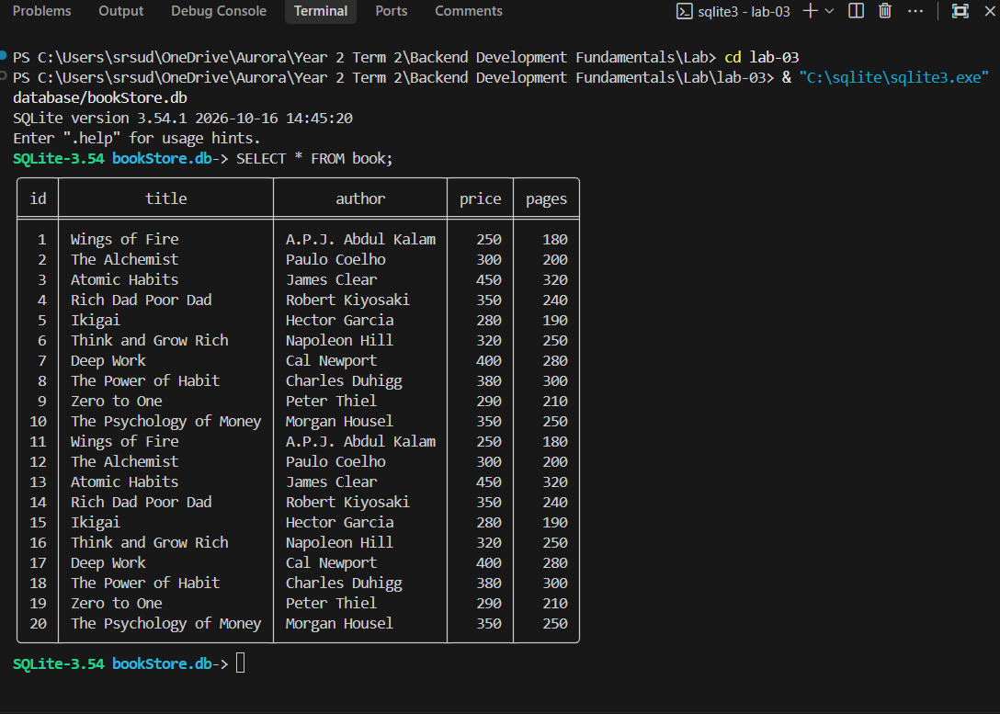

### 2. Express Server Startup with Nodemon
Displays Nodemon listening and running on `http://localhost:3000/`:
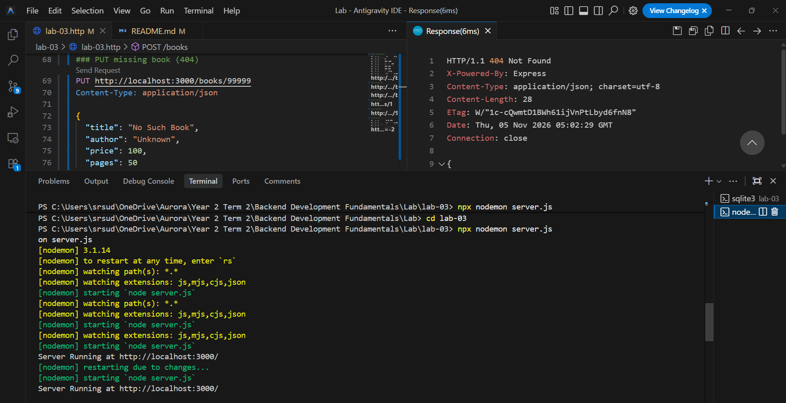

### 3. Search Query Parameter (`GET /books?search_q=fire`)
- **Render Live URL:** [https://backend-lab-lab-03.onrender.com/books?search_q=fire](https://backend-lab-lab-03.onrender.com/books?search_q=fire)
- **Expected HTTP Status:** `200 OK`

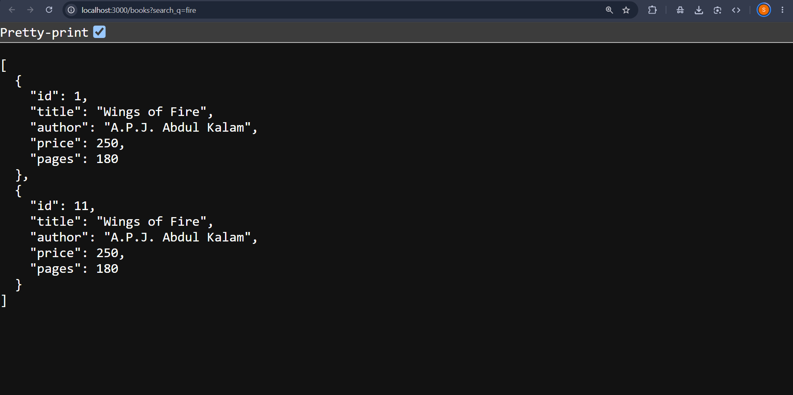

### 4. Sorting by Price Descending (`GET /books?order_by=price&order=DESC`)
- **Render Live URL:** [https://backend-lab-lab-03.onrender.com/books?order_by=price&order=DESC](https://backend-lab-lab-03.onrender.com/books?order_by=price&order=DESC)
- **Expected HTTP Status:** `200 OK`

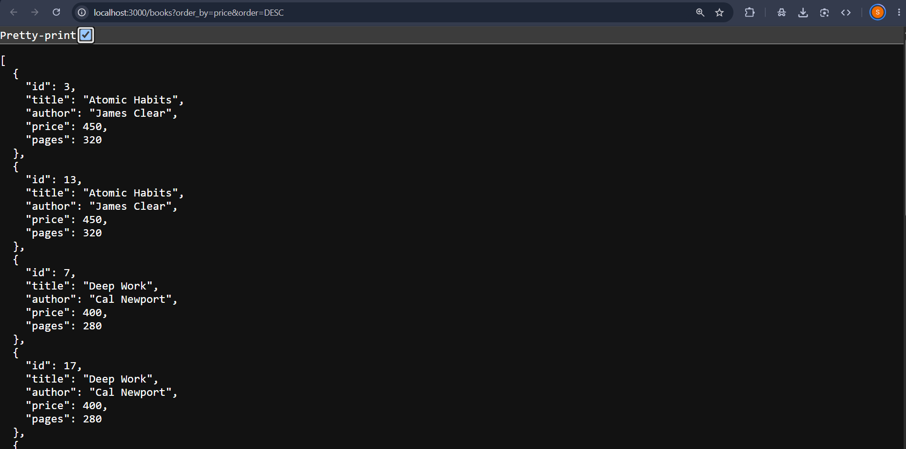

### 5. Pagination with Limit & Offset (`GET /books?limit=2&offset=5`)
- **Render Live URL:** [https://backend-lab-lab-03.onrender.com/books?limit=2&offset=5](https://backend-lab-lab-03.onrender.com/books?limit=2&offset=5)
- **Expected HTTP Status:** `200 OK`

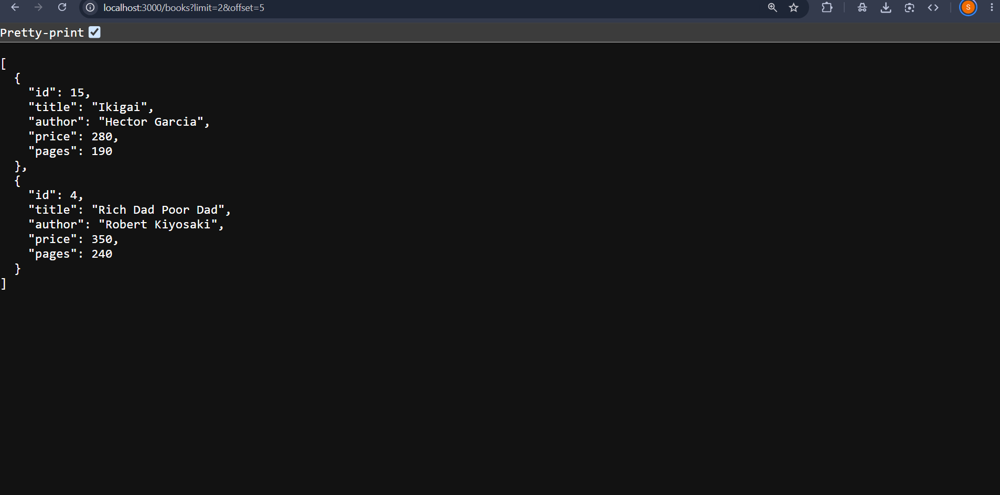

### 6. Price Range Filter (`GET /books?min_price=250&max_price=400`)
- **Render Live URL:** [https://backend-lab-lab-03.onrender.com/books?min_price=250&max_price=400](https://backend-lab-lab-03.onrender.com/books?min_price=250&max_price=400)
- **Expected HTTP Status:** `200 OK`

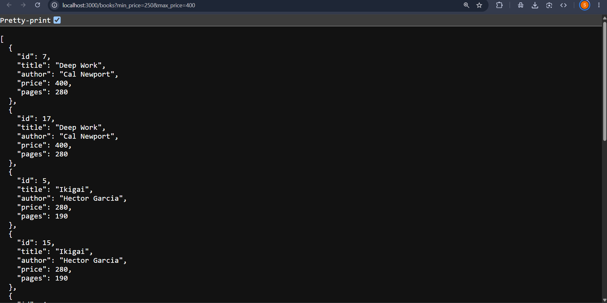

### 7. POST Create Valid Book (`201 Created`)
- **Expected HTTP Status:** `201 Created`

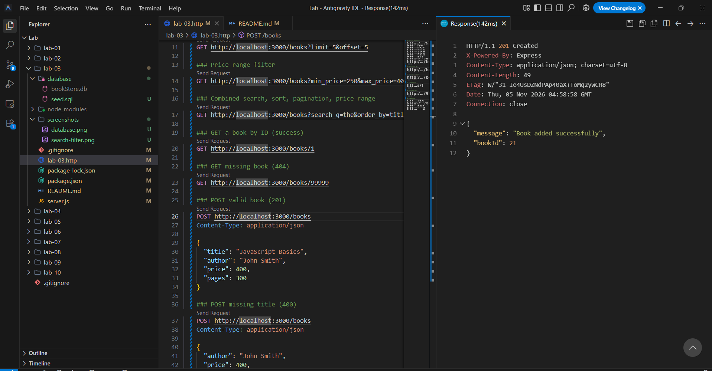

### 8. GET Missing Book (`404 Not Found` on `/books/99999`)
- **Render Live URL:** [https://backend-lab-lab-03.onrender.com/books/99999](https://backend-lab-lab-03.onrender.com/books/99999)
- **Expected HTTP Status:** `404 Not Found`

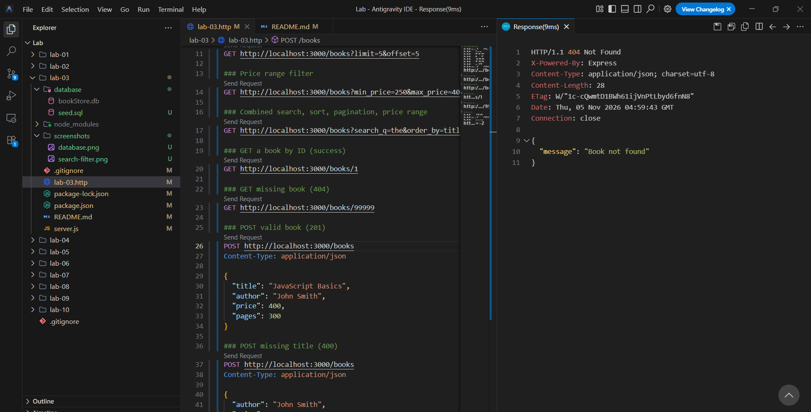

### 9. PUT Update Valid Book (`200 OK` on `/books/1`)
- **Expected HTTP Status:** `200 OK`

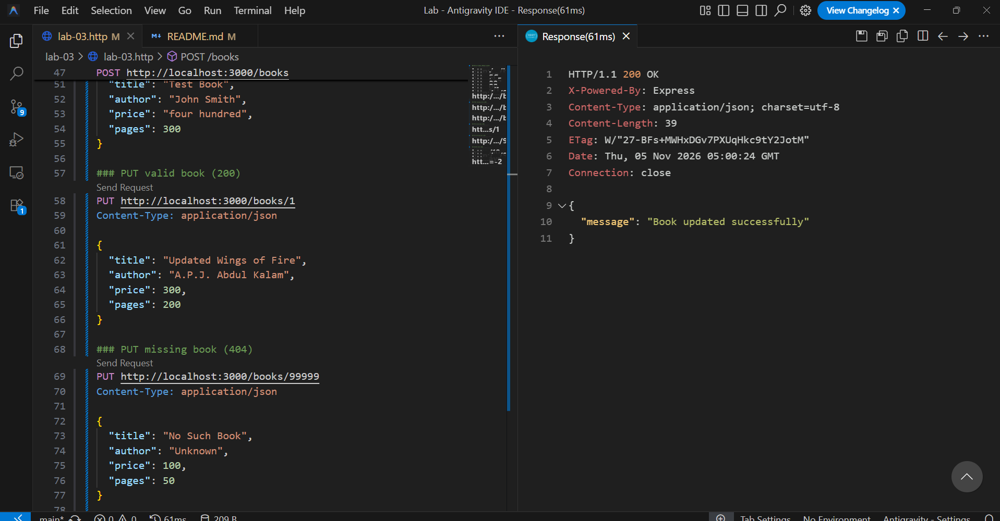

### 10. PUT Missing Book (`404 Not Found` on `/books/99999`)
- **Expected HTTP Status:** `404 Not Found`

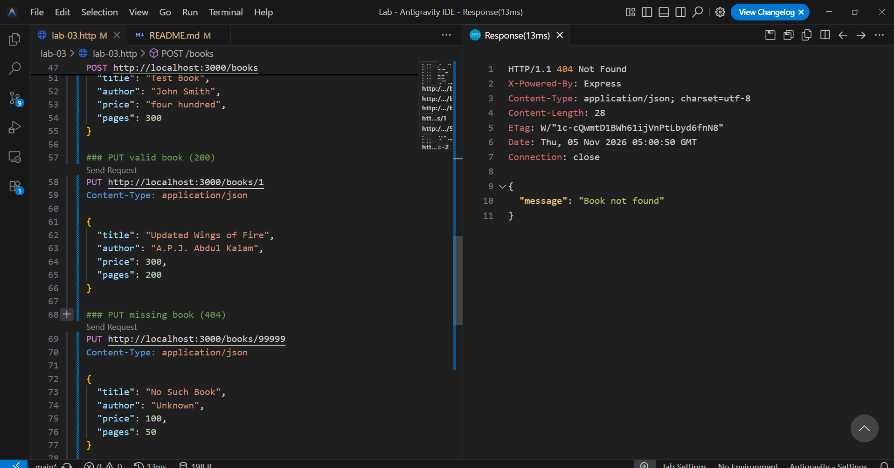

### 11. DELETE Book (`200 OK` on `/books/10`)
- **Expected HTTP Status:** `200 OK`

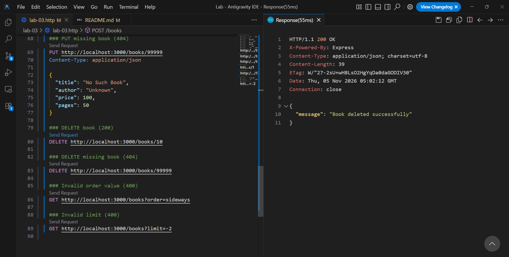

### 12. DELETE Missing Book (`404 Not Found` on `/books/99999`)
- **Expected HTTP Status:** `404 Not Found`

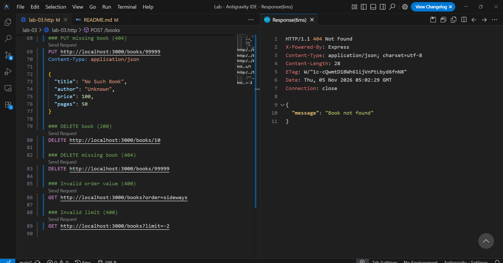

### 13. Project Structure & Explorer View
Shows complete project organization in the editor:
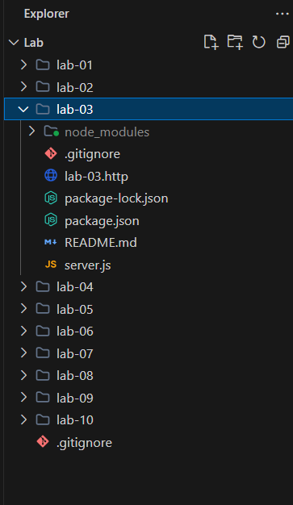

### 14. REST Client Test Suite (`lab-03.http`)
Displays the complete suite of tests configured in the HTTP client:
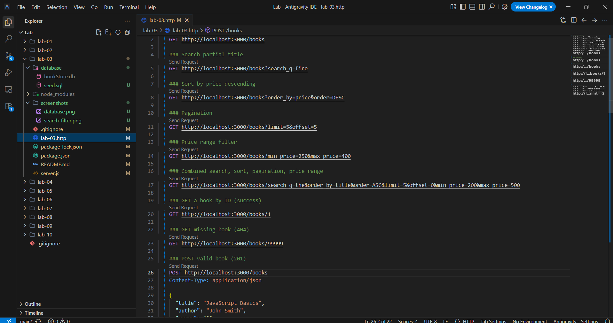

### 15. Server Source Code Implementation (`server.js`)
Shows clean REST routing, validation logic, and SQLite database connectivity:
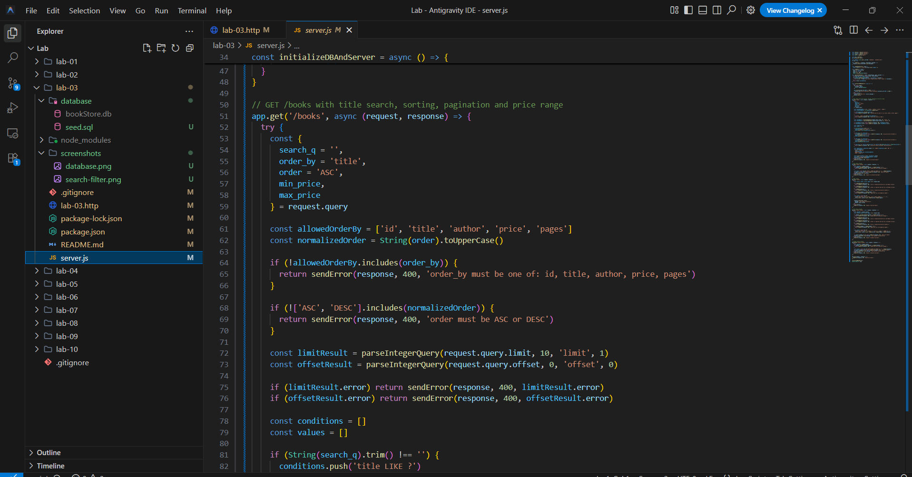

---

## ❗ Notes: Problems Faced and Solutions (Debugging Exercise)

As part of the lab debugging curriculum, four intentional errors were analyzed, diagnosed, and resolved:

| # | Error / Bug | Root Cause | Diagnosis & Solution |
|:---:|---|---|---|
| **1** | **Port Conflict (`EADDRINUSE`)** | Another process (e.g. earlier server instance) was already listening on port `3000`. | Made the port configurable using `process.env.PORT \|\| 3000`. Stopped competing background Node processes using Task Manager or PowerShell (`Stop-Process`), or launched on an alternative port via `$env:PORT=3001; npm run dev`. |
| **2** | **Wrong Import Path (`MODULE_NOT_FOUND`)** | Code used an incorrect relative path (e.g., `require('./sqlite3')` or misspelled package name) instead of installed npm package. | Verified `package.json` dependencies and corrected the import to use the exact package name `require('sqlite3')` and `{open} = require('sqlite')`. |
| **3** | **Table-Name Typo (`no such table: books`)** | The SQL query attempted to query `FROM books` (plural) whereas the database schema defined the table as `book` (singular). | Aligned all SQL queries in `server.js` with the exact schema table name: `SELECT * FROM book`, `INSERT INTO book`, `UPDATE book`, `DELETE FROM book`. |
| **4** | **Missing `await` on Database Call** | Asynchronous SQLite methods (`db.all()`, `db.get()`, `db.run()`) were invoked without `await`. | Express route handlers sent HTTP responses prematurely with empty objects `{}` while the underlying Promise was still pending. Added `await` before all database calls and declared route handler callbacks as `async`. |
| **5** | **Cloud Deployment Linux GLIBC Compatibility** | Native pre-built C++ binaries for `sqlite3` failing during compilation on Render Linux build environment. | Locked `sqlite3` to stable version `^5.1.7` (or `^6.0.1`) and ensured Node LTS version was specified in `package.json` engines or `.node-version`. |

---

## 🚀 Deployment on Render

### Steps to Deploy

1. **Sign up** on [Render](https://render.com/) using your GitHub account.

2. **Create a New Web Service:**
   - Click **"New +"** → **"Web Service"**
   - Connect your GitHub repository: `backend_lab`

3. **Configure the Service:**

   | Setting | Value |
   |---------|-------|
   | **Name** | `backend-lab-lab-03` |
   | **Root Directory** | `lab-03` |
   | **Runtime** | `Node` |
   | **Build Command** | `npm install` |
   | **Start Command** | `node server.js` |
   | **Environment Variable** | `NODE_VERSION: 20.18.0` |

4. **Deploy** and wait for the build to complete.

5. **Verify by visiting the deployed Render URLs:**
   - **Main Server / Student Info:** [https://backend-lab-lab-03.onrender.com/](https://backend-lab-lab-03.onrender.com/)
   - **GET All Books:** [https://backend-lab-lab-03.onrender.com/books](https://backend-lab-lab-03.onrender.com/books)
   - **GET Search Title:** [https://backend-lab-lab-03.onrender.com/books?search_q=fire](https://backend-lab-lab-03.onrender.com/books?search_q=fire)
   - **GET Sort by Price:** [https://backend-lab-lab-03.onrender.com/books?order_by=price&order=DESC](https://backend-lab-lab-03.onrender.com/books?order_by=price&order=DESC)
   - **GET Pagination:** [https://backend-lab-lab-03.onrender.com/books?limit=2&offset=5](https://backend-lab-lab-03.onrender.com/books?limit=2&offset=5)
   - **GET Price Filter:** [https://backend-lab-lab-03.onrender.com/books?min_price=250&max_price=400](https://backend-lab-lab-03.onrender.com/books?min_price=250&max_price=400)
   - **GET Combined Filters:** [https://backend-lab-lab-03.onrender.com/books?search_q=The&min_price=200&max_price=400&order_by=price&order=ASC&limit=5&offset=0](https://backend-lab-lab-03.onrender.com/books?search_q=The&min_price=200&max_price=400&order_by=price&order=ASC&limit=5&offset=0)
   - **GET Single Book (ID 1):** [https://backend-lab-lab-03.onrender.com/books/1](https://backend-lab-lab-03.onrender.com/books/1)
   - **GET 404 Error Test (ID 999):** [https://backend-lab-lab-03.onrender.com/books/999](https://backend-lab-lab-03.onrender.com/books/999)

---

## 🎓 Viva Voce Questions & Answers

| # | Question | Comprehensive Answer |
|:---:|---|---|
| **1** | **What is the difference between Path parameters and Query parameters?** | **Path parameters** (`req.params`) form an integral part of the URL path hierarchy and identify a specific unique resource (e.g. `/books/1`). **Query parameters** (`req.query`) appear after the `?` delimiter in key-value pairs (e.g. `?order_by=price&limit=5`) and are used to filter, sort, search, or paginate a collection without altering the identity of the target resource. |
| **2** | **What does "Stateless" mean in REST architecture?** | In REST architecture, statelessness means that the server stores no client session context between requests. Every individual HTTP request sent by a client must contain all information, parameters, and authentication credentials required to process it completely. This enables independent request processing, effortless horizontal scaling, and robust reliability. |
| **3** | **Which HTTP status code should be used for bad input versus a missing record?** | **HTTP 400 (Bad Request)** is returned when client input fails syntax or validation checks (e.g., missing mandatory body fields, non-numeric price, inverted price range, or invalid sort column). **HTTP 404 (Not Found)** is returned when the request syntax is valid, but the requested URI or entity ID does not exist in the database (e.g., `GET /books/999`). |
| **4** | **Why cannot SQL `ORDER BY` and `order` be parameterized with `?` placeholders?** | Prepared statements and parameter placeholders (`?`) are strictly designed to bind literal data values (strings, numbers, dates). The SQL query planner compiles query syntax before parameter binding; therefore, database engines do not allow binding SQL identifiers (column names, table names) or keywords (`ASC`/`DESC`) via placeholders. To prevent SQL injection, dynamic sorting must be validated against a hardcoded in-memory allowlist. |
| **5** | **How do parameterized queries prevent SQL injection?** | Parameterized queries separate SQL query instructions from user-supplied data. The SQL engine parses and compiles the query structure first. When values are subsequently supplied for `?` placeholders, the engine treats them exclusively as literal data values rather than executable SQL syntax, rendering injection payloads completely inert. |

---

## 📜 Core Rules & Academic Integrity

- **Environment & Secrets:** `.env` and `node_modules/` are strictly excluded from version control via `.gitignore`.
- **Credential Safety:** Passwords and secrets are never logged or stored in plain text.
- **HTTP Semantics:** Every route returns semantically accurate HTTP status codes (`200`, `201`, `400`, `404`, `500`).
- **Data Protection:** All database interactions utilize parameterized queries or identifier whitelists; dynamic SQL string concatenation is strictly prohibited.
- **Originality:** Code and documentation are authored and maintained by the student.

---

## ✅ Conclusion

Through **Lab 3**, I achieved the following learning outcomes:
1. Designed a clean, resource-oriented RESTful API following HTTP method conventions.
2. Built a dynamic multi-parameter filtering engine on `GET /books` supporting partial search, allowlisted column sorting, pagination, and numeric price ranges.
3. Enforced rigorous request payload validation with standardized JSON error responses.
4. Protected the database against SQL injection through prepared statement parameterization and allowlisting.
5. Diagnosed and documented core backend failure modes (`EADDRINUSE`, `MODULE_NOT_FOUND`, table typos, missing asynchronous awaits).
6. Executed comprehensive automated test suites using REST Client and Postman.

---

## 👤 Author & Academic Attribution

**SOMULA SUDHARSHAN REDDY**  
**Registration Number:** `252U1R1231`  
**Section:** `CSE-CORE-2E`  
**Department of Computer Science & Engineering**  
**Aurora Deemed-to-be-University**
